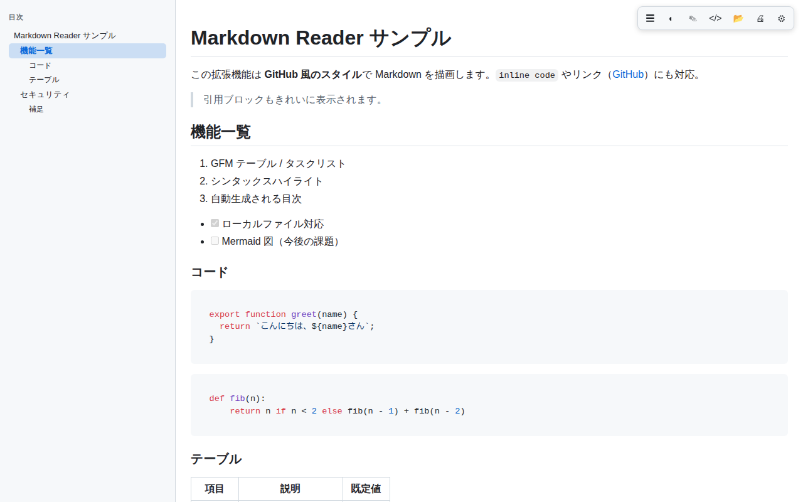

# Markdown Reader (Edge / Chrome 拡張機能)

ブラウザで開いた Markdown ファイル (`.md` など) を GitHub 風のスタイルで描画する Manifest V3 拡張機能です。
既存の「Markdown Viewer」が社内ポリシーで導入できない場合の自前代替として、ソースをすべて手元で管理・ビルドできます。



## 特長

- **完全オフライン動作** — 外部 CDN・外部 API へのアクセスは一切なし。描画に必要なライブラリはすべて同梱。
- **最小権限** — `storage` と `activeTab` のみ。全サイトへのアクセス権限は要求しません。
- **安全な描画** — [DOMPurify](https://github.com/cure53/DOMPurify) で HTML を無害化してから表示（`<script>` や `onerror` は除去）。
- **GitHub Flavored Markdown** — テーブル、タスクリスト、取り消し線、脚注付きのリスト等に対応。
- **シンタックスハイライト** — highlight.js（共通言語セット）を同梱。
- **目次サイドバー** — 見出しから自動生成し、スクロールに追従。
- **Markdown エディタ** — 表示中のファイルをその場で編集できるほか、専用エディタページで新規作成も可能（白紙・作業手順書などのテンプレートから選択）。プレビューのオン / オフ切替、Markdown とコードブロック（関数名・引数・キーワード等）のシンタックスハイライト付き。
- **ライト / ダークテーマ** — OS 設定に自動追従。コードテーマも選択可能。
- **その他** — 見出しアンカー、コードのコピーボタン、元 Markdown 表示トグル、印刷用スタイル、スクロール位置の記憶。

対応拡張子: `.md` `.markdown` `.mdown` `.mkd` `.mkdn` `.mdx` `.rmd`

## Microsoft Edge への導入方法

`dist/` はリポジトリに含まれているため、ビルドなしで導入できます。

1. リポジトリを取得する（`git clone` または GitHub の「Code → Download ZIP」で取得して展開）
2. Edge のアドレスバーに `edge://extensions` と入力して開く
3. 左側（または左下）の **「開発者モード」** をオンにする
4. **「展開して読み込み」** をクリックし、`manifest.json` があるこのリポジトリのフォルダーを選択する
5. 拡張機能の一覧に「Markdown Reader」が表示されれば導入完了
6. ローカルの `.md` を開きたい場合は、「Markdown Reader」の **「詳細」→「ファイルの URL へのアクセスを許可する」をオン** にする

ツールバーに表示するには、Edge 右上の拡張機能アイコン（パズル型）から「Markdown Reader」のピン留めをクリックしてください。

> - フォルダーを移動・削除すると拡張機能が無効になります。固定の場所に置いてください。
> - ソースを更新したら `edge://extensions` で「更新」ボタン（↻）を押すと反映されます。
> - 起動のたびに「開発者モードの拡張機能を無効にする」旨の警告が出る場合があります。社内ポリシーに従ってください。
> - Chrome でも同じ手順 (`chrome://extensions`) で動作します。

### ソースからビルドする場合

```bash
npm ci        # 依存関係の取得
npm run build # dist/ を生成（初回は npm run icons も実行）
```

配布用の zip は `npm run package` で `markdown-reader.zip` が生成されます
（Microsoft Partner Center / Chrome Web Store へのアップロードにも使えます）。

## 使い方

### 基本

- `.md` などの Markdown ファイルを Edge で開くだけで自動的に描画されます（`file://` と http(s) の両方）。
  - ローカルファイル: エクスプローラーからファイルを Edge にドラッグ＆ドロップするか、アドレスバーに `file:///C:/path/to/file.md` を入力します。
  - Web 上: `https://example.com/doc.md` のような URL（生の Markdown テキストが返るもの）。
- HTML として表示されるページ（GitHub 上の `README.md` ページなど）は書き換えません。

### ツールバー（ページ右上）

| ボタン | 機能 |
| --- | --- |
| `☰` | 目次サイドバーの表示 / 非表示 |
| `◐` | ライト / ダークテーマの切り替え |
| `✎` / `📖` | エディタを開く / 閉じて閲覧に戻る（`Ctrl+E`） |
| `</>` | 元の Markdown テキストの表示切り替え |
| `📂` | ファイルを開く（`Ctrl+O`） |
| `🖨` | 印刷（印刷用スタイルで出力） |
| `⚙` | 設定ページを開く |

編集中は次のボタンが追加されます。

| ボタン | 機能 |
| --- | --- |
| `💾` | 保存（`Ctrl+S`） |
| `👁` | 編集中のプレビューの表示 / 非表示（`Alt+P`） |

- 見出しにマウスを乗せるとアンカーリンクが表示されます。
- コードブロックにはコピーボタンが表示されます。
- スクロール位置は記憶されます。
- Edge のツールバーにある拡張機能アイコンをクリックすると、ポップアップから同じ操作ができます。

### エディタ

- **その場で編集**: 表示中の Markdown で `✎`（`Ctrl+E`）を押すとエディタが開きます。
- **専用エディタ**: ツールバーの拡張機能アイコン →「Markdown エディタを開く」で、ファイルを開かずに新規作成・編集できる専用ページが開きます。`🆕` で新規作成、`📂` / ファイルのドラッグ＆ドロップで開く、`💾` で保存。入力内容は自動で退避され、次回開いたときに復元されます。
- **テンプレートから新規作成**: ツールバーの拡張機能アイコン →「新規 Markdown を作成」、または専用エディタの `🆕` を押すとテンプレート選択ダイアログが開きます。
  - **白紙** — 空のドキュメント
  - **作業手順書** — 文書管理情報・目的・作業概要・事前準備チェックリスト・注意事項・作業手順（操作 / 期待結果 / 確認）・作業後確認・切り戻し手順・緊急連絡先・作業記録・改訂履歴の枠組み入り。作成日などには今日の日付が入り、保存時のファイル名は `作業手順書_YYYYMMDD.md` が提案されます。
  - **作業手順書（現場向け）** — 管理番号・作成日・分類・施設名、文書作成者 / 作業責任者 / 承認者、特記事項、必要工具・保護具（準備チェック付き）、作業手順（作業前確認〜片付けまで）、改訂履歴の枠組み入り。ファイル名は `現場作業手順書_YYYYMMDD.md` が提案されます。
  - テンプレートは `src/templates.js` の `TEMPLATES` 配列に追加すると選択肢に増やせます。
- **プレビューのオン / オフ**: `👁` または `Alt+P` で編集中のプレビューを表示 / 非表示にできます。非表示にするとエディタが全幅になり、描画処理も止まるため大きなファイルでも軽快です。2カラム表示ではエディタのスクロールにプレビューが追従します。
- **シンタックスハイライト**: 見出し・強調・リンク / URL・リスト / タスク・引用・表・HTML などを色分けします。` ```js ` のようなコードブロック内は言語に応じて関数名・引数・キーワード・文字列・コメント等が色分けされます（配色はコードのテーマ設定に従います）。
- **入力補助**: 書式ボタン、`Ctrl+B` / `Ctrl+I` / `Ctrl+K`、リストの自動継続、`Tab` でのインデント。
- **ステータスバー**: カーソル位置（行・列）、文字数、保存状態を表示。未保存時はタブのタイトルに `●` が付きます。

### 設定

設定ページ（`⚙` または `edge://extensions` →「拡張機能のオプション」）で次を変更できます。

- テーマ、コードのハイライトテーマ
- 本文幅、文字サイズ
- 各機能（目次、コピーボタン等）のオン / オフ
- エディタのレイアウト（2カラム / トグル式）、編集中のプレビュー表示、シンタックスハイライト、オートセーブ
- 自動描画の除外オリジン

### うまく表示されないとき

- ローカルファイルが描画されない → 「ファイルの URL へのアクセスを許可する」がオンか確認
- 拡張機能を更新した後に変わらない → `edge://extensions` で更新後、ページを再読み込み
- 特定サイトで描画したくない → 設定の除外オリジンに追加

## 開発

| コマンド | 内容 |
| --- | --- |
| `npm run build` | `src/` を `dist/` にバンドルし、CSS とライセンス一覧を更新 |
| `npm run icons` | `icons/*.png` を生成（外部依存なし） |
| `npm test` | ビルド後、実ブラウザ上で描画・XSS・テーマ等を検証するスモークテスト |
| `npm run package` | 配布用 zip を作成 |

### 構成

```
manifest.json          拡張機能の定義 (MV3)
src/content.js         .md を検出して描画するコンテンツスクリプト
src/viewer.js          ビューアー / エディタ本体（コンテンツスクリプトと専用エディタで共用）
src/md-highlight.js    エディタ用の Markdown シンタックスハイライター
src/editor.html/.js    Markdown 専用エディタページ
src/templates.js       新規作成用のテンプレート（白紙・作業手順書など）
src/settings.js        設定のデフォルト値と保存・読み込み
src/background.js      サービスワーカー（設定ページの起動など）
src/options.html/.js   設定ページ
src/popup.html/.js     ツールバーのポップアップ
css/                   ビューアーのスタイル・GitHub テーマ・コードテーマ
dist/                  ビルド成果物（拡張機能が読み込む）
test/smoke.mjs         実ブラウザでのスモークテスト
```

### 設計上の注意

- HTML ページを壊さないよう、`document.contentType` がプレーンテキスト系で、かつ body が単一の `<pre>` の場合のみ描画します（GitHub 上の `README.md` ページなどは書き換えません）。
- 描画結果は必ず DOMPurify を通します。`marked` の出力をそのまま DOM に挿入しないでください。

## セキュリティ / プライバシー

- 通信を行うコードはありません（`fetch` は拡張機能内の CSS 読み込みのみ）。
- 収集・送信するデータはありません。設定は `chrome.storage` に保存されるだけです。
- 同梱ライブラリとそのライセンスは [THIRD_PARTY_LICENSES.md](THIRD_PARTY_LICENSES.md) を参照してください。

## ライセンス

MIT License（[LICENSE](LICENSE)）
