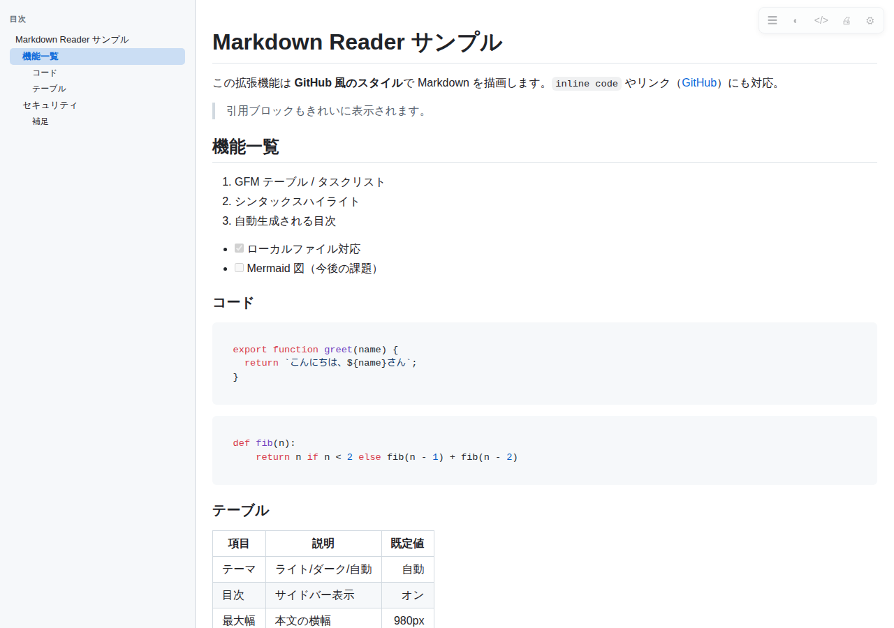

# Markdown Reader (Edge / Chrome 拡張機能)

ブラウザで開いた Markdown ファイル (`.md` など) を GitHub 風のスタイルで描画する Manifest V3 拡張機能です。
既存の「Markdown Viewer」が社内ポリシーで導入できない場合の自前代替として、ソースをすべて手元で管理・ビルドできます。



## 特長

- **完全オフライン動作** — 外部 CDN・外部 API へのアクセスは一切なし。描画に必要なライブラリはすべて同梱。
- **最小権限** — `storage` と `activeTab` のみ。全サイトへのアクセス権限は要求しません。
- **安全な描画** — [DOMPurify](https://github.com/cure53/DOMPurify) で HTML を無害化してから表示（`<script>` や `onerror` は除去）。
- **GitHub Flavored Markdown** — テーブル、タスクリスト、取り消し線、脚注付きのリスト等に対応。
- **シンタックスハイライト** — highlight.js（共通言語セット）を同梱。
- **目次サイドバー** — 見出しから自動生成し、スクロールに追従。
- **ライト / ダークテーマ** — OS 設定に自動追従。コードテーマも選択可能。
- **その他** — 見出しアンカー、コードのコピーボタン、元 Markdown 表示トグル、印刷用スタイル、スクロール位置の記憶。

対応拡張子: `.md` `.markdown` `.mdown` `.mkd` `.mkdn` `.mdx` `.rmd`

## インストール（開発者モードで読み込む）

```bash
npm ci        # 依存関係の取得
npm run build # dist/ を生成（初回は npm run icons も実行）
```

1. Edge で `edge://extensions` を開く
2. 左下の「開発者モード」をオンにする
3. 「展開して読み込み」をクリックし、このリポジトリのフォルダーを選択する
4. ローカルの `.md` を開きたい場合は、拡張機能の「詳細」→ **「ファイルの URL へのアクセスを許可する」をオンにする**

> Chrome でも同じ手順 (`chrome://extensions`) で動作します。

配布用の zip を作る場合は `npm run package` を実行すると `markdown-reader.zip` が生成されます
（Microsoft Partner Center / Chrome Web Store へのアップロードにも使えます）。

## 使い方

- `.md` ファイルを開くだけで自動的に描画されます（`file://` と http(s) の両方）。
- 右上のツールバー: `☰` 目次 / `◐` テーマ切替 / `</>` 元の Markdown 表示 / `🖨` 印刷 / `⚙` 設定
- ツールバーのアイコンをクリックするとポップアップから同じ操作ができます。
- 設定ページでテーマ、本文幅、文字サイズ、各機能のオン/オフ、自動描画の除外オリジンを変更できます。

## 開発

| コマンド | 内容 |
| --- | --- |
| `npm run build` | `src/` を `dist/` にバンドルし、CSS とライセンス一覧を更新 |
| `npm run icons` | `icons/*.png` を生成（外部依存なし） |
| `npm test` | ビルド後、実ブラウザ上で描画・XSS・テーマ等を検証するスモークテスト |
| `npm run package` | 配布用 zip を作成 |

### 構成

```
manifest.json          拡張機能の定義 (MV3)
src/content.js         .md を検出して描画するコンテンツスクリプト
src/settings.js        設定のデフォルト値と保存・読み込み
src/background.js      サービスワーカー（設定ページの起動など）
src/options.html/.js   設定ページ
src/popup.html/.js     ツールバーのポップアップ
css/                   ビューアーのスタイル・GitHub テーマ・コードテーマ
dist/                  ビルド成果物（拡張機能が読み込む）
test/smoke.mjs         実ブラウザでのスモークテスト
```

### 設計上の注意

- HTML ページを壊さないよう、`document.contentType` がプレーンテキスト系で、かつ body が単一の `<pre>` の場合のみ描画します（GitHub 上の `README.md` ページなどは書き換えません）。
- 描画結果は必ず DOMPurify を通します。`marked` の出力をそのまま DOM に挿入しないでください。

## セキュリティ / プライバシー

- 通信を行うコードはありません（`fetch` は拡張機能内の CSS 読み込みのみ）。
- 収集・送信するデータはありません。設定は `chrome.storage` に保存されるだけです。
- 同梱ライブラリとそのライセンスは [THIRD_PARTY_LICENSES.md](THIRD_PARTY_LICENSES.md) を参照してください。

## ライセンス

MIT License（[LICENSE](LICENSE)）
