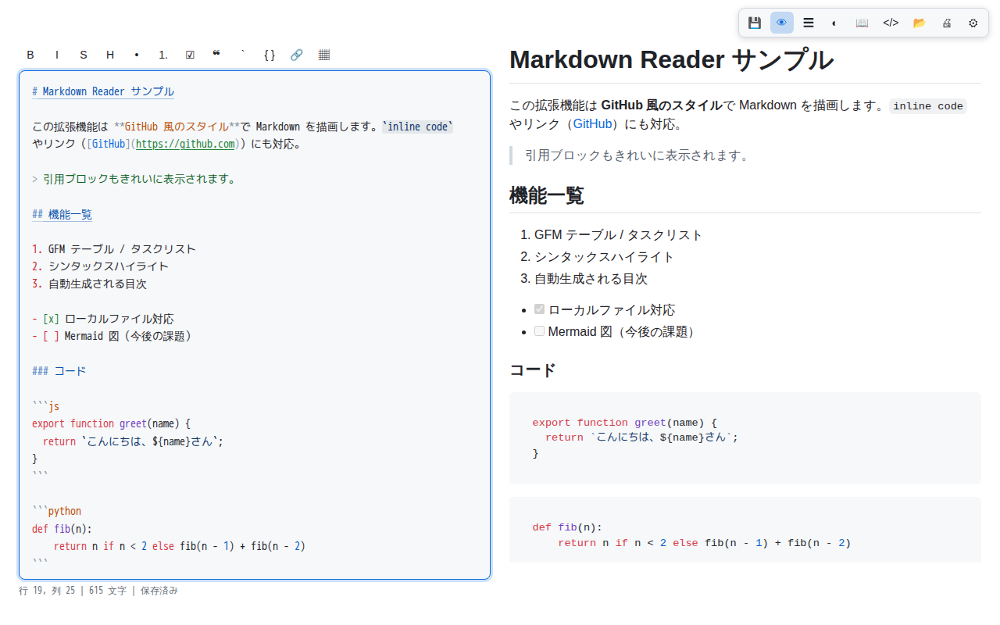
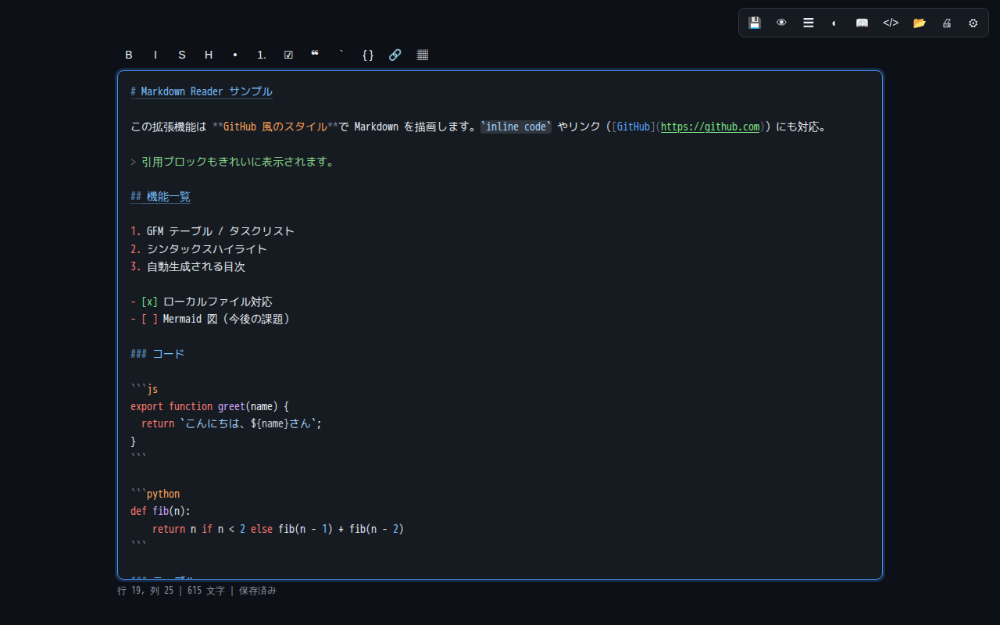
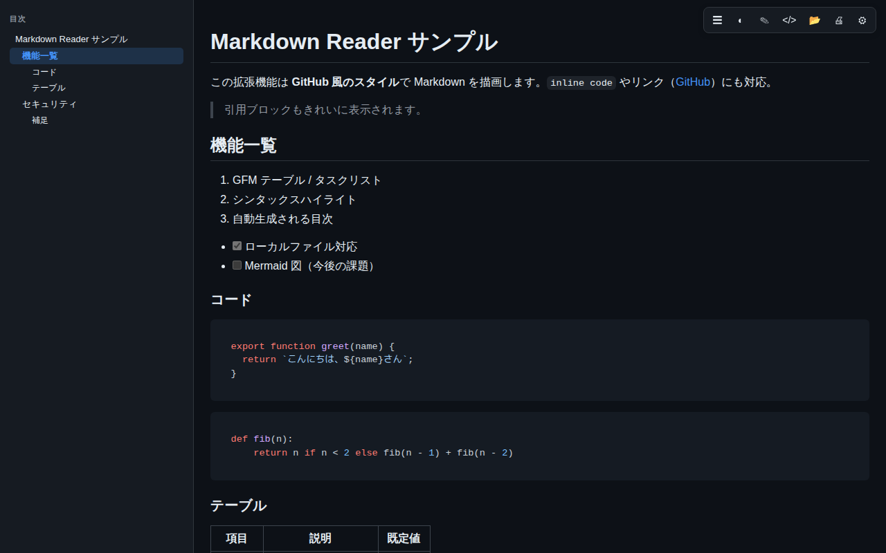
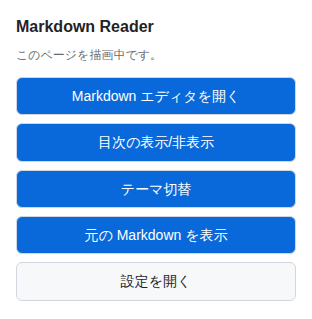

# Markdown Reader (Edge / Chrome 拡張機能)

ブラウザで開いた Markdown ファイル (`.md` など) を GitHub 風のスタイルで描画し、そのまま**編集**もできる Manifest V3 拡張機能です。
外部通信を一切行わない完全オフライン設計で、ソースをすべて手元で管理・ビルドできます。既存の「Markdown Viewer」が社内ポリシーで導入できない場合の自前代替としても使えます。


| エディタ（2カラム + プレビュー） | エディタ（プレビュー非表示・ダーク） |
| --- | --- |
|  |  |

## 特長

### ビューアー

- **GitHub Flavored Markdown** — テーブル、タスクリスト、取り消し線、自動リンクなどに対応。
- **シンタックスハイライト** — highlight.js（主要言語セット）を同梱。
- **目次サイドバー** — 見出しから自動生成し、スクロール位置に追従。
- **ライト / ダークテーマ** — OS 設定に自動追従。コードの配色テーマも選択可能。
- **便利機能** — 見出しアンカー、コードのコピーボタン、元 Markdown 表示、印刷用スタイル、スクロール位置の記憶。

### エディタ

- **その場で編集** — 表示中の Markdown を `Ctrl+E` で編集モードに切り替え。
- **専用エディタページ** — ファイルを開かずに新規作成・編集できる独立したページ。
- **プレビューのオン / オフ** — 編集中のプレビューを `Alt+P` で表示 / 非表示。プレビューはエディタのスクロールに追従。
- **見やすい色分け表示** — Markdown 記法を色分けし、コードブロック内は言語に応じて**関数名・引数・キーワード・文字列・コメント**などを色分け。
- **入力補助** — 書式ボタン、ショートカット、リストの自動継続、ステータスバー（行・列・文字数・保存状態）。
- **ファイル保存とオートセーブ** — ローカルファイルを開いて上書き保存。入力内容は自動で退避され、閉じても失われません。

### 安全性

- **完全オフライン動作** — 外部 CDN・外部 API へのアクセスは一切なし。描画に必要なライブラリはすべて同梱。
- **最小権限** — `storage` と `activeTab` のみ。全サイトへのアクセス権限は要求しません。
- **安全な描画** — [DOMPurify](https://github.com/cure53/DOMPurify) で HTML を無害化してから表示（`<script>` や `onerror` は除去）。

対応拡張子: `.md` `.markdown` `.mdown` `.mkd` `.mkdn` `.mdx` `.rmd`

## Microsoft Edge への導入方法

`dist/` はリポジトリに含まれているため、ビルドなしで導入できます。

1. リポジトリを取得する（`git clone` または GitHub の「Code → Download ZIP」で取得して展開）
2. Edge のアドレスバーに `edge://extensions` と入力して開く
3. 左側（または左下）の **「開発者モード」** をオンにする
4. **「展開して読み込み」** をクリックし、`manifest.json` があるこのリポジトリのフォルダーを選択する
5. 拡張機能の一覧に「Markdown Reader」が表示されれば導入完了
6. ローカルの `.md` を開きたい場合は、「Markdown Reader」の **「詳細」→「ファイルの URL へのアクセスを許可する」をオン** にする

ツールバーに表示するには、Edge 右上の拡張機能アイコン（パズル型）から「Markdown Reader」のピン留めをクリックしてください。

> - フォルダーを移動・削除すると拡張機能が無効になります。固定の場所に置いてください。
> - ソースを更新したら `edge://extensions` で「更新」ボタン（↻）を押すと反映されます。
> - 起動のたびに「開発者モードの拡張機能を無効にする」旨の警告が出る場合があります。社内ポリシーに従ってください。
> - Chrome でも同じ手順 (`chrome://extensions`) で動作します。

## 使い方

### Markdown を表示する

- `.md` などの Markdown ファイルを Edge で開くだけで自動的に描画されます（`file://` と http(s) の両方）。
  - ローカルファイル: エクスプローラーからファイルを Edge にドラッグ＆ドロップするか、アドレスバーに `file:///C:/path/to/file.md` を入力します。
  - Web 上: `https://example.com/doc.md` のような URL（生の Markdown テキストが返るもの）。
- HTML として表示されるページ（GitHub 上の `README.md` ページなど）は書き換えません。



### ページ右上のツールバー

| ボタン | 機能 | ショートカット |
| --- | --- | --- |
| `☰` | 目次サイドバーの表示 / 非表示 | |
| `◐` | テーマの切り替え（自動 → ライト → ダーク） | |
| `✎` / `📖` | エディタを開く / 閉じて閲覧に戻る | `Ctrl+E` |
| `</>` | 元の Markdown テキストの表示切り替え | |
| `📂` | ファイルを開く | `Ctrl+O` |
| `🖨` | 印刷（印刷用スタイルで出力） | |
| `⚙` | 設定ページを開く | |

編集中は次のボタンが追加されます。

| ボタン | 機能 | ショートカット |
| --- | --- | --- |
| `💾` | 保存（初回は保存先を選択、以降は上書き） | `Ctrl+S` |
| `👁` | 編集中のプレビューの表示 / 非表示 | `Alt+P` |
| `🆕` | 新規作成（専用エディタページのみ） | |

- 見出しにマウスを乗せるとアンカーリンクが表示されます。
- コードブロックにはコピーボタンが表示されます。
- ツールバーは普段は半透明で、マウスを乗せるとはっきり表示されます。

### ポップアップ



Edge のツールバーにある拡張機能アイコンをクリックすると、次の操作ができます。

- **Markdown エディタを開く**（専用エディタページを新しいタブで開く）
- このページを Markdown として表示（自動描画しない設定のときなど）
- 目次の表示 / 非表示、テーマ切替、元の Markdown の表示
- 設定を開く

<br clear="right">

## エディタ

### 2 つの使い方

- **表示中のファイルを編集**: Markdown を表示した状態で `✎`（`Ctrl+E`）を押すと、エディタとプレビューが並んで表示されます。
- **専用エディタページ**: ポップアップの「Markdown エディタを開く」から起動します。ファイルを開かなくても書き始められ、`🆕` で新規作成、`📂`（`Ctrl+O`）やファイルのドラッグ＆ドロップで既存ファイルを開けます。前回の入力内容は次に開いたとき自動で復元されます。

### プレビューのオン / オフ

- `👁` ボタンまたは `Alt+P` で、編集中のプレビューを表示 / 非表示にできます。
- 非表示にするとエディタが全幅になり、執筆に集中できます。描画処理も止まるため大きなファイルでも軽快です（再表示時に最新の内容で描画）。
- 2 カラム表示では、エディタをスクロールするとプレビューも同じ位置まで追従します。
- 設定で「トグル式」レイアウトを選ぶと、`👁` / `Alt+P` でエディタとプレビューを 1 画面で切り替えます。

### 見やすさの工夫（シンタックスハイライト）

エディタの文字は種類ごとに色分けされます。配色はライト / ダークテーマに合わせて切り替わります。

| 対象 | 例 | 表示 |
| --- | --- | --- |
| 見出し | `## 見出し` | 青色 + 下線（`#` 記号は淡色） |
| 強調 | `**太字**` / `*斜体*` / `~~取消~~` | 橙 / 紫 / 取り消し線 |
| コード | `` `code` `` | 背景付き |
| リンク | `[テキスト](https://...)` | テキストは青、URL は緑の下線 |
| リスト・タスク | `- ` `1. ` `[ ]` `[x]` | 記号を赤、完了タスクは緑 |
| 引用・表・HTML | `> ` `\|` `<kbd>` | 緑 / 黄 / ピンク |
| フロントマター | `---` で囲んだ YAML | 淡色 |
| **コードブロック** | ` ```js ` ` ```python ` など | **関数名・引数・キーワード・文字列・数値・コメントを言語ごとに色分け**（設定の「コードのテーマ」に従う） |

- 文字の太さや形を変えずに色だけで表現しているため、カーソル位置がずれません。
- 設定でハイライトをオフにすることもできます。

### 入力補助

| 操作 | 内容 |
| --- | --- |
| 書式ボタン | 太字・斜体・取り消し線・見出し・箇条書き・番号付きリスト・タスク・引用・インラインコード・コードブロック・リンク・表 |
| `Ctrl+B` / `Ctrl+I` / `Ctrl+K` | 太字 / 斜体 / リンク |
| `Enter` | リスト・番号・タスクを自動で継続（空の項目で `Enter` するとリスト終了） |
| `Tab` | インデント（スペース 2 つ） |

- 画面下のステータスバーに、カーソル位置（行・列）、選択文字数、総文字数、ファイル名、保存状態を表示します。
- 未保存の変更があるとタブのタイトルに `●` が付き、ページを閉じる前に確認が表示されます。

### 保存とオートセーブ

- `💾`（`Ctrl+S`）で保存します。初回は保存先を選び、以降は同じファイルに上書きします。
- オートセーブがオンの場合、入力内容をブラウザ内に自動退避し、開いたファイルにも自動で書き込みます。

## 設定

設定ページ（`⚙`、またはポップアップの「設定を開く」、`edge://extensions` →「拡張機能のオプション」）で次を変更できます。変更は開いているページにすぐ反映されます。

| 分類 | 項目 |
| --- | --- |
| 表示 | テーマ、コードのハイライトテーマ（GitHub / a11y / Monokai / Nord）、本文の最大幅、文字サイズ |
| エディタ | 画面レイアウト（2 カラム分割 / トグル式）、編集中のプレビュー表示、シンタックスハイライト、オートセーブ |
| 機能 | 目次、見出しアンカー、コピーボタン、スクロール位置の記憶、改行の扱い |
| 自動描画 | http(s) 上の `.md` を自動描画するか、自動描画しないオリジン |

## うまく動かないとき

| 症状 | 対処 |
| --- | --- |
| ローカルファイルが描画されない | 「ファイルの URL へのアクセスを許可する」がオンか確認 |
| 拡張機能を更新しても変わらない | `edge://extensions` で更新（↻）後、ページを再読み込み |
| 特定サイトで描画したくない | 設定の「自動描画しないオリジン」に追加 |
| 保存ダイアログが出ずにダウンロードされる | ブラウザがファイル保存 API に未対応のため。ダウンロードされたファイルを利用してください |

## 開発

### ソースからビルドする

```bash
npm ci        # 依存関係の取得
npm run build # dist/ を生成（初回は npm run icons も実行）
```

| コマンド | 内容 |
| --- | --- |
| `npm run build` | `src/` を `dist/` にバンドルし、CSS とライセンス一覧を更新 |
| `npm test` | ビルド後、実ブラウザに拡張機能を読み込んで描画・エディタ・XSS 対策などを検証 |
| `npm run screenshots` | README 用のスクリーンショット (`docs/*.png`) を再生成 |
| `npm run icons` | `icons/*.png` を生成（外部依存なし） |
| `npm run package` | 配布用 zip (`markdown-reader.zip`) を作成（Microsoft Partner Center / Chrome Web Store にも利用可） |

> テストとスクリーンショットには Playwright 用の Chromium が必要です（`npx playwright-core install chromium`）。

### 構成

```
manifest.json          拡張機能の定義 (MV3)
src/content.js         .md を検出して描画を開始するコンテンツスクリプト
src/viewer.js          ビューアー / エディタ本体（コンテンツスクリプトと専用エディタで共用）
src/md-highlight.js    エディタ用の Markdown シンタックスハイライター
src/editor.html/.js    Markdown 専用エディタページ
src/settings.js        設定のデフォルト値と保存・読み込み
src/background.js      サービスワーカー（設定ページの起動など）
src/options.html/.js   設定ページ
src/popup.html/.js     ツールバーのポップアップ
css/                   ビューアー / エディタのスタイル・GitHub テーマ・コードテーマ
dist/                  ビルド成果物（拡張機能が読み込む）
test/smoke.mjs         実ブラウザでのスモークテスト
tools/                 アイコン・スクリーンショットの生成スクリプト
docs/                  スクリーンショット・資料
```

### 設計上の注意

- HTML ページを壊さないよう、`document.contentType` がプレーンテキスト系で、かつ body が単一の `<pre>` の場合のみ描画します（GitHub 上の `README.md` ページなどは書き換えません）。
- 描画結果は必ず DOMPurify を通します。`marked` の出力をそのまま DOM に挿入しないでください。
- エディタのハイライトは `textarea` の背面に色付きの `<pre>` を重ねる方式です。両者のフォント・余白・折り返し設定を一致させる必要があり、ハイライトでは文字幅が変わる装飾（太字・斜体など）を使いません。

## セキュリティ / プライバシー

- 通信を行うコードはありません（`fetch` は拡張機能内の CSS 読み込みのみ）。
- 収集・送信するデータはありません。設定は `chrome.storage`、エディタの下書きはブラウザの `localStorage` に保存されるだけです。
- 同梱ライブラリとそのライセンスは [THIRD_PARTY_LICENSES.md](THIRD_PARTY_LICENSES.md) を参照してください。

## ライセンス

MIT License（[LICENSE](LICENSE)）
