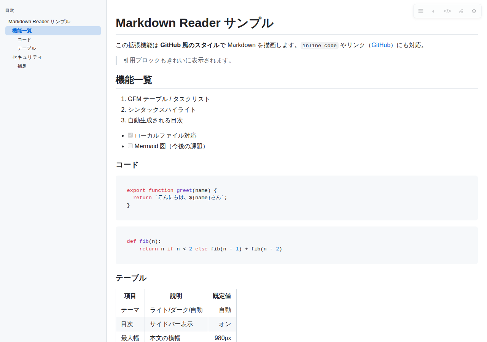
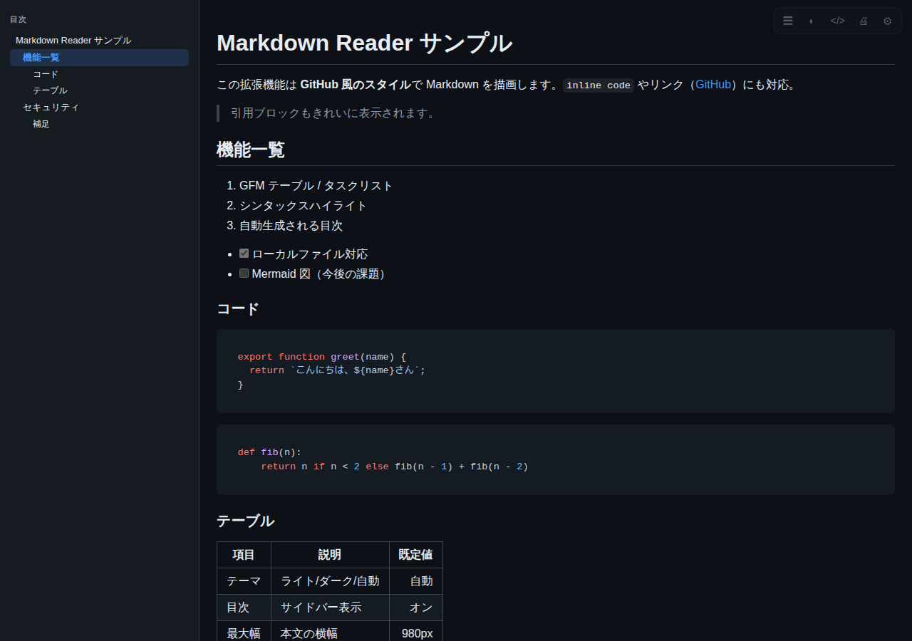

# 創意工夫提案書

## 提案名

**「Markdown Reader」── 社内製・完全オフラインの Markdown 閲覧ブラウザ拡張機能の導入**

| 項目 | 内容 |
| --- | --- |
| 提案者 | （氏名・所属を記入） |
| 提案日 | （記入） |
| 対象 | 事務所全体（Microsoft Edge / Google Chrome 利用者） |
| 導入コスト | ライセンス費用 0 円（MIT License・自社管理のソースのみ） |

---

## 1. 提案の背景 ── 先を見据えた開発

### AI時代の事務処理に向けた「共通言語」が必要

- 省人化・省力化のため、**将来、事務処理の大半は AI に役割を移していく**ことが想定される。
- Word・Excel など Microsoft 系の形式（docx / xlsx）は、AI にとって**構造の読み取りや生成が難しく、互換性が悪い**。AI に任せる業務で、うまく動作しないおそれがある。
- そこで、**人間・コンピュータ・AI の三者が共通で読み書きできる言語**が必要になる。その有力な答えが **Markdown（.md）**である。
  - プレーンテキストなので、AI が正確に読み書きできる。
  - 見出し・表・リストなどの構造を記号で表現でき、人間にも読める。
  - 軽量で、履歴管理・検索・再利用がしやすい。
- **今後、社内で .md を扱う機会は確実に増える。** 本提案は、その需要が顕在化する前に、先駆けて環境を整えるものである。

### 現状の課題

- 現在、.md を開く手段は事実上**メモ帳**のみ。
  - 記号（`#` `**` `|---|`）だらけの生テキストで、**見づらい**。
  - 表が崩れ、見出し構造も分からず、編集も**使いづらい**。
- 既存の外部製 Markdown 拡張機能は、**社内ポリシーにより導入できない**。
- このままでは、AI 活用が進んでも「**人が読める形で確認できない**」ことがボトルネックになる。

## 2. 提案内容

そこで、ブラウザで開いた `.md` を**自動で見やすい文書として表示する拡張機能**を自社開発した。
ソースをすべて自社で管理しているため、**社内ポリシーに適合した形で安全に導入**できる。
これは、AI 時代の事務処理に向けた**最初の基盤**である。

## 3. どんなことができるか（機能）

| 機能 | 内容 |
| --- | --- |
| 自動描画 | `.md` / `.markdown` / `.mdx` / `.rmd` などをブラウザで開くだけで整形表示（ローカルファイル・Web 上の両方） |
| GitHub 風の見やすいデザイン | 見出し、表、リスト、タスクリスト、引用、取り消し線、脚注に対応 |
| コードのシンタックスハイライト | 主要言語に対応。コードのコピーボタン付き |
| 目次サイドバー | 見出しから自動生成。長い文書でも目的の箇所へ即移動、スクロールに追従 |
| ライト / ダークテーマ | OS 設定に自動追従。目の疲れを軽減 |
| 元 Markdown 表示切替 | ワンクリックで原文と整形表示を切り替え |
| 印刷用スタイル | 印刷・PDF 保存に適したレイアウトで出力 |
| スクロール位置の記憶 | 再度開いたときに続きから閲覧 |
| 設定 | 本文幅・文字サイズ・テーマ・各機能の ON/OFF・除外サイトの指定 |

## 4. 優れている点

### ① 安全性（情報セキュリティ）

- **完全オフライン動作**：外部 CDN・外部 API への通信コードが一切ない。データの収集・送信なし。
- **最小権限**：要求する権限は `storage`（設定保存）と `activeTab` のみ。**全サイトへのアクセス権限は不要**。
- **安全な描画**：DOMPurify で無害化してから表示。文書内の `<script>` や不正な属性（`onerror` 等）は除去される。
- **ソースが透明**：コード量が小さく（約 1,000 行規模）、レビュー・監査が容易。同梱ライブラリとライセンスも一覧化済み。

### ② 内製による管理しやすさ

- 提供元不明の拡張機能と違い、**ソース・ビルド手順がすべて手元にある**ため、変更・更新・停止を自社で判断できる。
- 外部サービスの仕様変更・提供終了・突然の有料化の影響を受けない。
- MIT License で、費用・ライセンス管理が不要。

### ③ 導入の容易さ

- ビルド済みの `dist/` を同梱しており、**ビルド作業なしで導入可能**（Edge/Chrome の「展開して読み込み」）。
- 配布用 zip の作成コマンドも用意済み。将来的に社内ストア配布やグループポリシー配布へ発展可能。

### ④ 品質

- 実ブラウザ上で描画・XSS 対策・テーマ等を検証する自動スモークテストを用意。

## 5. 会社・事務所にとってのメリット

### 業務効率の向上

- **AI が作成した文書・AI に渡す指示書を、人が確認・修正できる**（AI 業務のチェック工程を支える）。
- 生成 AI の出力、手順書、README、議事録などを**開いてすぐ読める**。変換作業が不要になる。
- 目次ジャンプにより、長文ドキュメントから必要箇所を探す時間を短縮。
- 文書を Markdown で管理する運用（軽量・バージョン管理しやすい）を**現場が取り入れやすく**なる。

### 品質・ナレッジ共有の向上

- 表や見出しが正しく表示され、**読み間違い・認識齟齬が減る**。
- 手順書やマニュアルを Markdown で書いて共有する文化づくりの土台になる。
- 印刷用スタイルにより、紙・PDF での共有も簡単。

### コスト削減

- ライセンス費用 0 円。有償ツールや専用エディタの追加導入が不要。
- 目安の試算（実績値に置き換えてください）：
  - 1 人あたり月 30 分の「読みづらさ・変換作業」の削減 × 利用者数 N 人 × 12 か月
  - 例：N = 20 人 → 30 分 × 20 人 × 12 か月 = **年間 約 120 時間の削減**

### セキュリティ・コンプライアンス

- 外部通信なし・最小権限のため、情報漏えいリスクを増やさずに利便性を向上できる。
- 「ポリシーで使えない」という理由で個人判断の野良ツールが使われる**シャドー IT を抑止**できる。

## 6. 導入方法・スケジュール案

1. リポジトリ（またはビルド済み zip）を共有フォルダーに配置
2. `edge://extensions` で開発者モードをオン →「展開して読み込み」
3. ローカル `.md` を開く場合は「ファイルの URL へのアクセスを許可する」をオン

| 時期 | 内容 |
| --- | --- |
| 第 1 段階 | 情報システム担当によるセキュリティレビュー |
| 第 2 段階 | 数名でのパイロット運用・フィードバック収集 |
| 第 3 段階 | 事務所全体へ展開（手順書配布） |

## 7. 留意点と対応

| 留意点 | 対応 |
| --- | --- |
| 「展開して読み込み」では起動時に開発者モード警告が出る場合がある | 社内ポリシーに従う。将来的にはポリシー配布やストア公開（zip 作成済み）を検討 |
| フォルダー移動・削除で無効になる | 固定の場所に配置する旨を手順書に明記 |
| 保守担当 | 担当者を決め、依存ライブラリの更新（`npm run build`、テスト `npm test`）を定期実施 |

## 8. 今後の展開

- AI に任せる事務処理の入出力形式を Markdown に統一（AI 連携の土台）

- 社内ポリシー配布による一括導入
- 社内テンプレート（議事録・手順書）の整備と Markdown 運用ルール化
- 図表（Mermaid 等）や数式への対応拡張

## 9. まとめ

**費用ゼロ・外部通信なし・最小権限**で、増え続ける Markdown 文書を誰でも読みやすく表示できる、**安全で管理しやすい内製ツール**です。
業務効率化・ナレッジ共有の促進・セキュリティ維持を同時に実現できるため、事務所全体への導入を提案します。
